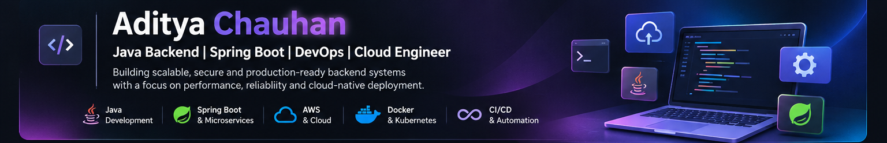

# Hi, I'm Aditya Chauhan 👋

 

### Java Backend Engineer | Spring Boot | Microservices | AWS | Cloud & DevOps

*Building scalable backend systems, event-driven applications, and cloud-native solutions.*

---

## 👨‍💻 About Me

I'm **Aditya Roshan Chauhan**, a Software Engineer with **3 years and 7 months of experience**, primarily focused on Java backend development and enterprise application engineering.

I have worked on backend applications across banking and healthcare domains, building REST APIs, microservices, database integrations, event-driven workflows, and cloud deployment pipelines.

My technical experience also extends to TypeScript, JavaScript, Node.js, and modern web application development.

- 🔭 Working on backend services, distributed systems, and cloud-native applications.
- ☕ Primary expertise: Java, Spring Boot, Microservices, REST APIs, and SQL.
- 🔄 Interested in event-driven architecture, system design, and scalable applications.
- ☁️ Hands-on experience with AWS, Docker, ECS, and CI/CD.
- 🌐 Additional development experience with TypeScript, Node.js, and React ecosystem technologies.
- 🧪 Focused on clean code, automated testing, debugging, and performance optimization.
- 📍 Based in India.

---

## 🛠️ Technology Stack

### ☕ Backend Development — Primary Stack

### 🟢 JavaScript & TypeScript Ecosystem

### 🏗️ Architecture, APIs & Messaging

### 🗄️ Databases & Data Technologies

### ☁️ Cloud, DevOps & Infrastructure

**AWS Services:** EC2 · S3 · ECS Fargate · ECR · RDS · VPC · IAM · ALB · CloudFront · Route 53 · ACM · Secrets Manager · Parameter Store · CloudWatch

### 🧪 Testing & Development Tools

---

## 🚀 Featured Projects

### 1. Paymesh — Event-Driven Digital Wallet Platform

**Java 21 · Spring Boot · Microservices · Apache Kafka · MySQL**

A digital wallet platform designed around independent backend services and event-driven communication.

**Key implementation areas:**
- Wallet creation and balance management.
- Money transfer workflows.
- User, Wallet, Transaction, and Notification services.
- Kafka-based asynchronous communication.
- Transaction processing and service integration.

**Architecture direction:**
- API Gateway and JWT-based security.
- Event-driven transaction orchestration.
- Containerized development and deployment.

**Repository:** Add the published Paymesh repository URL here.

---

### 2. Showtime — Movie Ticket Booking System

**Java · Spring Boot · Spring Data JPA · Kafka · MySQL · Docker**

A backend application for movie discovery and ticket-booking workflows.

- Designed and developed **20+ REST APIs**.
- Implemented movie catalog and booking functionality.
- Integrated relational persistence using Spring Data JPA.
- Used Kafka for event-driven integration.
- Containerized the application using Docker.

**Repository:** [SpringBoot Projects](https://github.com/adityachauhan564/SpringBoot_Projects)

---

### 3. Digital Library Management System

**Java · Spring Boot · Spring Data JPA · MySQL**

A backend application for managing digital library resources.

- Developed REST APIs for library operations.
- Integrated MySQL using Spring Data JPA.
- Implemented database-driven business functionality.
- Improved data retrieval performance by **40%**.

**Repository:** Add the direct repository or project-folder URL.

---

### 4. Healthcare EMR Platform — Backend & Cloud Engineering

**Java · Spring Boot · Microservices · TypeScript · Node.js · React · PostgreSQL · AWS · Docker**

Experience contributing to a multi-tenant healthcare application and its cloud infrastructure.

- Developed backend services supporting patient onboarding, appointments, SOAP notes, prescriptions, billing, and audit logging.
- Worked with API integrations and relational database workflows.
- Used Kafka for asynchronous notifications and service communication.
- Worked with Docker and AWS ECS deployment workflows.
- Contributed to cloud infrastructure involving RDS, ECR, ALB, S3, CloudFront, IAM, and monitoring.

---

## ☁️ AWS & DevOps — Practical Experience

Hands-on experience with cloud deployment and infrastructure workflows.

| Area | Technologies |
| :--- | :--- |
| **Compute** | EC2, ECS Fargate |
| **Containers** | Docker, ECR |
| **Networking** | VPC, Public/Private Subnets, Security Groups |
| **Database** | Amazon RDS PostgreSQL |
| **Storage** | S3 |
| **Content Delivery** | CloudFront |
| **Load Balancing** | Application Load Balancer |
| **Security** | IAM, ACM, Secrets Manager |
| **Configuration** | Systems Manager Parameter Store |
| **DNS** | Route 53 |
| **Monitoring** | CloudWatch |
| **CI/CD** | GitHub Actions, OIDC |

---

## 🏆 Achievements

- 🥇 CodeChef Global Rank 148 — Top 0.5% (November 2022).
- 🏅 Best Team Award at Tata Consultancy Services (October 2024).
- 🧪 Improved unit test coverage from **25% to 89%**.
- 🛠️ Resolved **50+ production defects**.
- ⚡ Optimized **20+ SQL queries**.

---

## 🎓 Education

**Bachelor of Technology — Information Technology**  
Galgotias College of Engineering and Technology, India  
2018 – 2022

---

## 📊 GitHub Activity

  

*GitHub's native contribution calendar on this profile is the source of truth for contribution activity. Third-party cards may occasionally be unavailable.*

---

## 🤝 Let's Connect

  

**Open to opportunities and conversations around Backend Engineering, Java, Cloud, DevOps, and Distributed Systems.**

